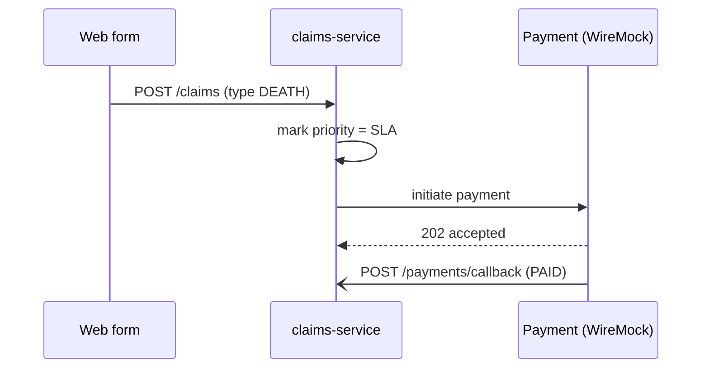
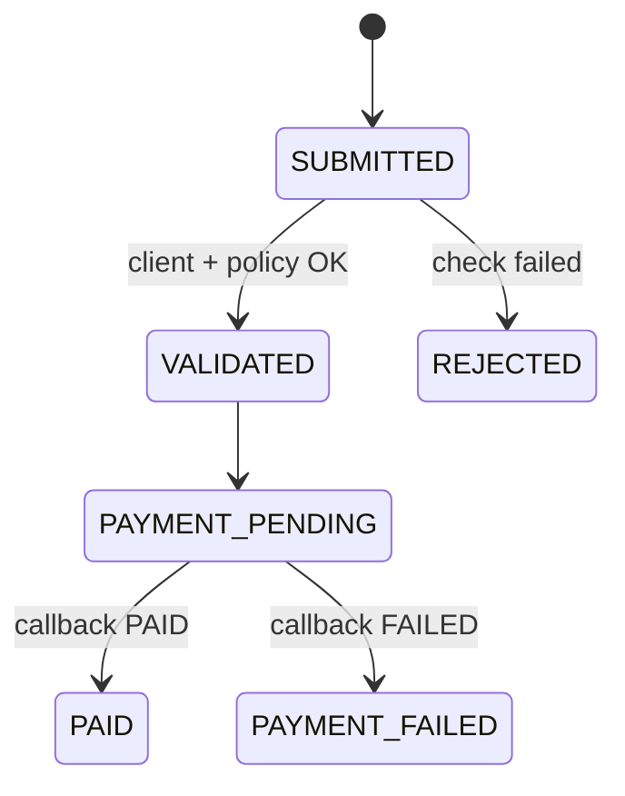

# mermaid-diagrams

**Called by:** the developer, `implement-ticket` (flow or state changed), or as a follow-up suggested by
`review-changes` (diagram out of date).
**Input:** what changed (e.g. "new `PENDING_PAYMENT` status", "Policy Manager now called before
Client Registry") and which diagram(s) it affects.
**Returns:** the proposed diagram text and a one-line note per change, then STOP. Save it only once
the developer approves, then hand control back to the caller.

## Files
One concept per Markdown file in `docs/diagrams/`: a one-line purpose, one ```` ```mermaid ```` block,
a short legend. Typical files: `context.md`, `sequence-submit-claim.md`,
`sequence-payment-callback.md`, `state-claim.md`. Ask before adding a new file.

## Pick the type
- Who talks to whom → `flowchart LR` with `subgraph` boxes. **No C4 keywords** (`C4Context`,
  `Person()`, `Rel()`...): GitHub shows them as raw text.
- Calls in order → `sequenceDiagram`.
- Claim status changes → `stateDiagram-v2`.
- AWS services appear only in the docs' deployment view, labelled as proposed.

## Examples (adapt to what the docs actually say)



Before proposing: keep labels short, make sure every participant/state exists in the code or docs,
and check the block parses (paste into mermaid.live or preview it).
