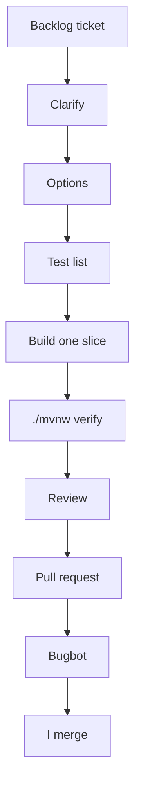

# How I used AI

The brief asks how AI was used, what it was used for, and the approach followed. I used it on the design and on almost every ticket. I kept the decisions, and I committed, pushed, and merged myself.

## Tools and roles

Three tools, with different jobs.

**Cursor** ran as a local agent in the IDE. It wrote the code and the tests, one backlog ticket at a time. Each ticket had its own git worktree, so two tickets could run in parallel without sharing a working tree.

 
 **Grok Bot** mainly a research assistant. I used it to read the brief and check my understanding, research options (e.g. LocalStack Community, SLA alarm approache), ask clarifying questions about concepts and endpoints, and sanity-check the agent's stop outputs and test lists before I made the call. Decisions stayed mine.

**Cursor Bugbot** reviewed pull requests and commented as itself (`cursor[bot]`). It commented on every pull request from #2 onward. Pull request #1, the Spring Boot build, has no Bugbot comment.

## Project context and skills

The rules the agent had to follow are in `AGENTS.md`. The golden rule is: never assume. If the brief or the docs are unclear, stop and ask. I make the decision.

The same file sets the hexagonal layer map. Dependencies point inward: `config`, then `adapter`, then `application`, then `domain`. The domain is plain Java, with no Spring, Jakarta, or Jackson. The application layer has no Spring annotations. Request and response types are explicit records, converted by a mapper in the adapter. External DTOs stay inside their adapter. Injection is by constructor.

The method is in `.agents/skills`. Each skill stops and waits for me.

- **implement-ticket** runs a code ticket: clarify, options with a recommendation and slices, a test list, one slice, `./mvnw verify`, then a review. A hard-to-reverse choice, a new test, or a changed flow calls the matching skill below.
- **test-strategy** names the tests before they are written: plain JUnit in the domain, fakes for use cases, MockMvc for the web, WireMock for outbound HTTP (happy path, 4xx, 5xx, timeout), a small repository contract, and one Spring Boot end-to-end test. Layering stays with ArchUnit.
- **review-changes** only reports. It checks the diff against the ticket, `solution.md`, the ADRs, and `AGENTS.md`, ranked must-fix, should-fix, or nit.
- **architecture-decision-record** drafts an ADR in `docs/adr/` for a hard-to-reverse choice. I approve the text before it is saved. It stays Proposed until I accept it.
- **mermaid-diagrams** drafts a diagram in `docs/diagrams/` when a flow, a status, or an external call changes: a flowchart for context, a sequence for call order, a state diagram for status. I approve it before it is saved.
- **plan-ticket** is the same loop for a docs-only ticket (scope, ADRs, diagrams, the solution write-up), with a consistency check in place of tests and a build.

## How I worked

I approved every gate before the agent continued. I committed, pushed, and merged. A choice that later work had to live with went into an ADR: 0001 single service and outbound ports, 0002 the payment webhook, 0003 death-claim priority, and 0004 SLA alarms. Anything still open stayed in the Open table in `solution.md`.

## What I accepted

On pull request #17 ("Error handling responses and strict ArchUnit layers") I took two designs together. Web errors return a Spring `ProblemDetail` body, the RFC 7807 format (`application/problem+json`). An unexpected failure is a generic 500 and is logged. The same pull request removed the ArchUnit empty-layer allowances, so each layer has to contain classes. The dependency rules themselves were already in pull request #2.

Bugbot's review of #17 caught a real bug. The catch-all `@ExceptionHandler(Exception.class)` also caught Spring MVC client errors (`NoResourceFoundException`, `HttpRequestMethodNotSupportedException`), so an unknown path and a wrong method came back as 500 instead of 404 and 405. The fix is in that same pull request: if the exception is an `ErrorResponse`, the handler returns Spring's own status.

## What I rejected or corrected

`@ExceptionHandler(ErrorResponse.class)` does not compile. `ErrorResponse` is not a `Throwable`, so it cannot be an exception-handler type. The `instanceof` check inside the catch-all is what shipped.

The outbound client tests started with a 300 ms read timeout on every call. The first JDK HTTP call on a cold JVM can exceed that, so unrelated tests failed. In pull request #15 ordinary calls use a 5 second read timeout, and only the timeout tests use 300 ms, against a WireMock response delayed by 1.5 seconds.

I also changed the prompts. A stop that only asked open questions was slow to answer. I asked the research assistant to recommend an option and say why. I still made the choice.

## The review that mattered

A review of the repository against the brief found the use cases built and unit-tested, and most of them absent from the running application. `UseCaseConfig` exposed submit, get, and apply-payment-status. Client check, policy check, straight-through payment, initiate payment, and the worker were not Spring beans, and nothing scheduled the worker. A submitted claim stayed `ACCEPTED`.

That became the backlog ticket "Wire the claim flow": beans for those use cases, a scheduled worker, `POST /claims/{id}/decision`, and `ClaimFlowEndToEndTest`. The test submits over HTTP, runs the worker against one WireMock server for the Client Registry, the Policy Manager, and Payment, and an eligible funeral claim reaches `PAID` after a signed callback. A death claim waits for an analyst, an unknown client is rejected, and a death claim is taken before an earlier funeral claim. Green unit tests had not shown that the system runs from submit to paid.

## Guardrails

The agent did not push or merge. I did. Tests do not call AWS. SQS and DynamoDB run only under the `localstack` profile, against the LocalStack community image on `localhost:4566`, with the dummy keys `test` / `test`. I kept secrets out of prompts. The callback secret in `application.yml` is a local sample value. A change was merged only after `./mvnw verify` (tests and the ArchUnit gate) and a review.

## Task log

| Task | Outcome | Notes |
|---|---|---|
| Claim intake endpoint | Accepted | POST /claims returns 201 and the new id. Invalid claims are 400 and are not queued. |
| Claim status endpoint | Accepted | GET /claims/{id} returns the stored claim. An unknown id is 404 and a non-UUID id is 400. |
| Payment status callback | Accepted | POST /payments/callback checks the HMAC signature and applies the payment status. Queueing the callback is deferred. |
| Reject incomplete payment callbacks | Accepted | A signed callback missing claimId, outcome, or idempotencyKey, or with an unknown outcome, returns 400 and does not call the use case. |
| Error handling and validation responses | Accepted | Web errors return a ProblemDetail body. An unexpected failure is a generic 500 and is logged. |
| Remove ArchUnit empty-layer allowances | Accepted | withOptionalLayers and failOnEmptyShould are removed. Each layer already has classes, and the dependency rules are unchanged. |
| Death-claim SLA warning and breach alarms | Accepted | Scheduled scan emits one warning and one breach through a logging port. CloudWatch stays the production option. |
| Claim.restore for a stored claim | Accepted | Restores the id, fields, status, reason, and events. Rejects a null id, a null status, a null or empty event list, and the same field and rejection-reason rules as accept. |
| LocalStack SQS and DynamoDB adapters | Accepted | Profile localstack switches on the SQS queue and DynamoDB repository. In-memory stays the default. A poison message, including an unknown claim type, is logged at WARN with the message id and is not deleted. |
| DynamoDB open death claims | Accepted | findOpenDeathClaims scans for DEATH claims in ACCEPTED or AWAITING_ANALYST and follows the page token. |
| LocalStack profile startup | Accepted | The localstack profile registers its settings bean, and Compose marks the init script executable before LocalStack starts. |
| Wire the claim-flow use cases and straight-through limit | Accepted | ClaimFlowConfig beans, limit default 10000.00, poll interval default PT5S. The context test binds that limit and a PT24H interval. The death-claim SLA scheduler waits for its check interval before the first run, and LocalStackConfigTest sets that interval to PT24H. |
| Schedule the claim worker | Accepted | Each tick drains until the queue is empty or 10 messages, and a process failure is logged at ERROR and ends that tick. The first tick waits for claims.worker.poll-interval. Context tests set that interval to PT24H. |
| Analyst decision endpoint | Accepted | POST /claims/{id}/decision. Approve moves an awaiting claim to APPROVED and starts payment; reject stores ANALYST_REJECTED. A claim that is not awaiting an analyst is 409. No auth in this sample. |
| End-to-end claim flow | Accepted | ClaimFlowEndToEndTest submits through one WireMock. An eligible funeral claim is paid after the worker and a signed callback. A death claim waits for an analyst, and an unknown client is rejected. A death claim is processed before an earlier funeral claim. |
