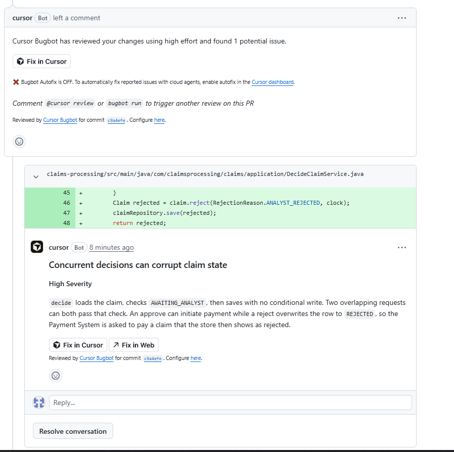
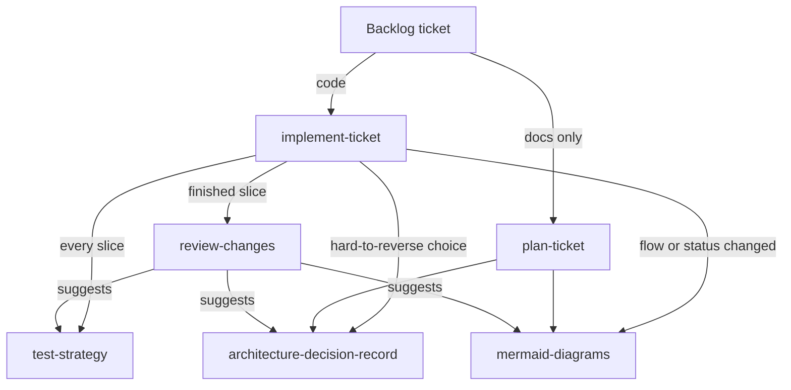
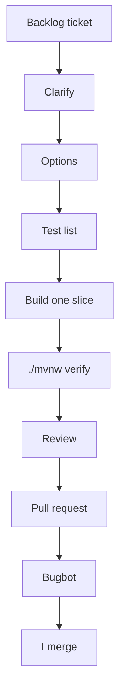

# How I used AI

The brief asks how AI was used, what it was used for, and the approach followed. I used it on the design and on almost every ticket. I kept the decisions, and I committed, pushed, and merged myself.

## Tools and roles

Three tools, with different jobs.

**Cursor** ran as a local agent in the IDE. It wrote the code and the tests, one backlog ticket at a time. Each ticket had its own git worktree, so two or more tickets could run in parallel without sharing a working tree.

**Grok Bot** mainly a research assistant. I used it to read the brief and check my understanding, research options (e.g. LocalStack Community, SLA alarm approache), ask clarifying questions about concepts and endpoints, and sanity-check the agent's stop outputs and test lists before I made the call. Decisions stayed mine.

**Cursor Bugbot** reviewed pull requests and commented as itself (`cursor[bot]`).

Example:

On pull request #20 it flagged a high-severity race in `DecideClaimService` (commit `c9a4efe`). `decide` loads the claim, checks `AWAITING_ANALYST`, then saves with no conditional write. Two overlapping requests can both pass that check. An approve can start payment while a reject overwrites the row to `REJECTED`, so the Payment System is asked to pay a claim the store then shows as rejected.

## Project context and skills

The rules the agent had to follow are in `AGENTS.md`. The golden rule is: never assume. If the brief or the docs are unclear, stop and ask. I make the decision.

The same file sets the hexagonal layer map. Dependencies point inward: `config`, then `adapter`, then `application`, then `domain`. The domain is plain Java, with no Spring, Jakarta, or Jackson. The application layer has no Spring annotations. Request and response types are explicit records, converted by a mapper in the adapter. External DTOs stay inside their adapter. Injection is by constructor.

The method is in `.agents/skills`. Six skills. Each one stops and waits for me, and a sub-skill hands control back to whoever called it. I can also call any skill on its own.

| Skill | What it does |
|---|---|
| `implement-ticket` | Runs a code ticket: clarify, options with a recommendation, one slice, `./mvnw verify`, then a review. |
| `plan-ticket` | Runs a docs-only ticket: decisions, a draft, a consistency check, then write. No tests and no build. |
| `test-strategy` | Names the tests before they are written: domain JUnit, use-case fakes, MockMvc, WireMock, a repository contract, one end-to-end test. |
| `architecture-decision-record` | Drafts an ADR in `docs/adr/` for a hard-to-reverse choice. I approve the text before it is saved. It stays Proposed until I accept it. |
| `mermaid-diagrams` | Drafts a diagram in `docs/diagrams/` when a flow, a status, or an external call changes. I approve it before it is saved. |
| `review-changes` | Reports on a finished slice against the ticket, `solution.md`, the ADRs, and `AGENTS.md`. It never edits the code. |

`implement-ticket` and `plan-ticket` are the two entry points. The other four are called from those, and `review-changes` can send the work back to three of them.

## How I worked

That is the loop inside `implement-ticket`. `plan-ticket` is the same shape without the test list, the slice, or `./mvnw verify`. I approved every gate before the agent continued. I committed, pushed, and merged. A choice that later work had to live with went into an ADR: 0001 single service and outbound ports, 0002 the payment webhook, 0003 death-claim priority, and 0004 SLA alarms. Anything still open stayed in the Open table in `solution.md`.

## What I accepted

I kept a suggestion only when I could say why it belonged in this service.

On pull request #17 ("Error handling responses and strict ArchUnit layers") I accepted two designs, each one because it closed a hole the sample would otherwise have shipped with.

Web errors return a Spring `ProblemDetail` body, the RFC 7807 format (`application/problem+json`). Callers get one error shape. An unexpected failure is a generic 500 and is logged, so a stack trace never becomes the response. That contract stays in the web adapter, which is where `AGENTS.md` puts HTTP.

The same pull request removed ArchUnit's empty-layer allowances (`withOptionalLayers`, `failOnEmptyShould`). The dependency rules were already in pull request #2. Once every layer had classes, an allowance for an empty layer would have let a later change delete `domain` or `application` and still pass the build. I kept the stricter rule. The gate is there to fail the build, not to be loosened when a change is inconvenient.

Bugbot's comment on that pull request is the other thing I kept, and only after I checked it against the code. The catch-all `@ExceptionHandler(Exception.class)` also matches Spring MVC client errors (`NoResourceFoundException`, `HttpRequestMethodNotSupportedException`), so an unknown path and a wrong method came back as 500. A problem-detail wrapper that lies about the status is worse than the old empty body. The fix, still on #17, returns Spring's own status when the exception is an `ErrorResponse`.

## What I rejected or corrected

A suggestion that compiled, or that merely sounded right, was not the bar. Three of them failed that check, and the repo has the version I changed.

The first proposed fix for the Bugbot comment was `@ExceptionHandler(ErrorResponse.class)`. It does not compile. `ErrorResponse` is not a `Throwable`, so it cannot be an exception-handler type. I threw that out. The `instanceof ErrorResponse` check inside the catch-all is what compiles, and it is what still returns 404 and 405.

The outbound client tests were first written with a 300 ms read timeout on every call. That is not the service timeout: `application.yml` uses 5 seconds. On a cold JVM the first JDK HTTP call can exceed 300 ms, so tests that were not about timeouts failed. I treated that as a bad test, not as a reason to weaken the timeout behaviour. In pull request #15 ordinary calls use 5 seconds, and only the timeout tests use 300 ms, against a WireMock response delayed by 1.5 seconds.

I also rejected the way the stops were written. A gate that only asked open questions handed the decision back with no recommendation and no trade-off. I changed the prompts so the assistant names an option and the reason. The choice stayed mine, which is the rule in `AGENTS.md`. Those choices are in the ADRs and the Open table in `solution.md`, not in the chat.

## The review that mattered

A review of the repository against the brief found the use cases built and unit-tested, and most of them absent from the running application. `UseCaseConfig` exposed submit, get, and apply-payment-status. Client check, policy check, straight-through payment, initiate payment, and the worker were not Spring beans, and nothing scheduled the worker. A submitted claim stayed `ACCEPTED`.

That became the backlog ticket "Wire the claim flow": beans for those use cases, a scheduled worker, `POST /claims/{id}/decision`, and `ClaimFlowEndToEndTest`. The test submits over HTTP, runs the worker against one WireMock server for the Client Registry, the Policy Manager, and Payment, and an eligible funeral claim reaches `PAID` after a signed callback. A death claim waits for an analyst, an unknown client is rejected, and a death claim is taken before an earlier funeral claim. Green unit tests had not shown that the system runs from submit to paid.

## Guardrails

The agent did not push or merge. I did. Tests do not call AWS. SQS and DynamoDB run only under the `localstack` profile, against the LocalStack community image on `localhost:4566`, with the dummy keys `test` / `test`. I kept secrets out of prompts. The callback secret comes from `PAYMENT_CALLBACK_SECRET`, with no default in the main profile. Tests set the fake value `dev-callback-secret`. A change was merged only after `./mvnw verify` (tests and the ArchUnit gate) and a review.

## With more budget

On this case study, with more budget, I would spend it on catching a weak change while it is still small.

- Bugbot on every push, rather than once per pull request, so a problem shows up before the change has grown.
- Mutation testing with PIT, and an agent fixing the mutants that survive. Coverage does not prove the assertions mean anything. A mutant that still passes is a test that did not notice a change in behaviour.

## In production

The same idea, with a human in charge of the merge.

CloudWatch alarms for a death-claim SLA breach, a dead-letter queue depth above zero, the API 5xx rate, and payment client errors would trigger an agent through EventBridge. The agent would pull the alarm, the related logs (correlated by claim id), and the recent deploys, find the likely cause, and open a draft pull request. The pull request would carry the fix, a regression test that reproduces the failure, and an incident summary.

That pull request would go through the same gates as any other change: CI, ArchUnit, security scanning, and Bugbot. I would review it and merge. The agent would not merge, deploy, or touch production data. Every fix would leave a test behind, so the same incident could not come back silently. The agent would run with least privilege: read-only access to logs and metrics, and write access only to a branch.

What stays human is the architecture and the ADRs, anything that touches payment rules or a regulatory requirement, and the merge. No client or claim data goes into a prompt. The agent sees ids and error details, not personal information.

## Task log

| Task | Outcome | Notes |
|---|---|---|
| Claim intake endpoint | Accepted | POST /claims returns 201 and the new id. Invalid claims are 400 and are not queued. |
| Claim status endpoint | Accepted | GET /claims/{id} returns the stored claim. An unknown id is 404 and a non-UUID id is 400. |
| Payment status callback | Accepted | POST /payments/callback checks the HMAC signature and applies the payment status. Queueing the callback is deferred. |
| Reject incomplete payment callbacks | Accepted | A signed callback missing claimId, outcome, or idempotencyKey, or with an unknown outcome, returns 400 and does not call the use case. |
| Error handling and validation responses | Accepted | Web errors return a ProblemDetail body. An unexpected failure is a generic 500 and is logged. |
| Remove ArchUnit empty-layer allowances | Accepted | withOptionalLayers and failOnEmptyShould are removed. Each layer already has classes, and the dependency rules are unchanged. |
| Death-claim SLA warning and breach alarms | Accepted | Scheduled scan emits one warning and one breach through a logging port. CloudWatch stays the production option. |
| Claim.restore for a stored claim | Accepted | Restores the id, fields, status, reason, and events. Rejects a null id, a null status, a null or empty event list, and the same field and rejection-reason rules as accept. |
| LocalStack SQS and DynamoDB adapters | Accepted | Profile localstack switches on the SQS queue and DynamoDB repository. In-memory stays the default. A poison message, including an unknown claim type, is logged at WARN with the message id and is not deleted. |
| DynamoDB open death claims | Accepted | findOpenDeathClaims scans for DEATH claims in ACCEPTED or AWAITING_ANALYST and follows the page token. |
| LocalStack profile startup | Accepted | The localstack profile registers its settings bean, and Compose marks the init script executable before LocalStack starts. |
| Wire the claim-flow use cases and straight-through limit | Accepted | ClaimFlowConfig beans, limit default 10000.00, poll interval default PT5S. The context test binds that limit and a PT24H interval. The death-claim SLA scheduler waits for its check interval before the first run, and LocalStackConfigTest sets that interval to PT24H. |
| Schedule the claim worker | Accepted | Each tick drains until the queue is empty or 10 messages, and a process failure is logged at ERROR and ends that tick. The first tick waits for claims.worker.poll-interval. Context tests set that interval to PT24H. |
| Analyst decision endpoint | Accepted | POST /claims/{id}/decision. Approve moves an awaiting claim to APPROVED and starts payment; reject stores ANALYST_REJECTED. A claim that is not awaiting an analyst is 409. No auth in this sample. |
| End-to-end claim flow | Accepted | ClaimFlowEndToEndTest submits through one WireMock. An eligible funeral claim is paid after the worker and a signed callback. A death claim waits for an analyst, and an unknown client is rejected. A death claim is processed before an earlier funeral claim. |
| Callback secret from the environment | Accepted | application.yml requires PAYMENT_CALLBACK_SECRET and has no default. A null secret fails in the properties constructor with that name, and a blank secret fails with "PAYMENT_CALLBACK_SECRET must be set". Tests set dev-callback-secret in src/test/resources/application.properties so the main application.yml still loads. |

