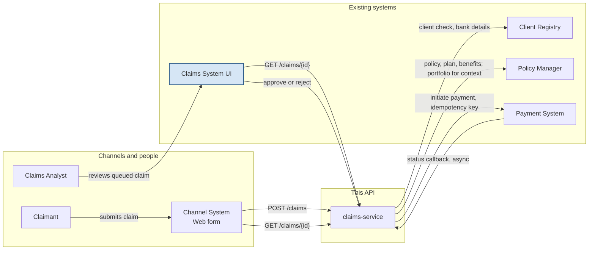

These systems are not connected today. This diagram shows the links the solution proposes.

## Legend

- Blue box: the Claims System UI already exists and is out of scope. This repo builds `claims-service`.
- A queued claim is approved or rejected in that UI. On approval, `claims-service` initiates payment. The decision endpoint is still open.
- Portfolio information is context only and does not decide pay-or-not.
- The payment-status callback is asynchronous. EventBridge versus SNS is still open.
