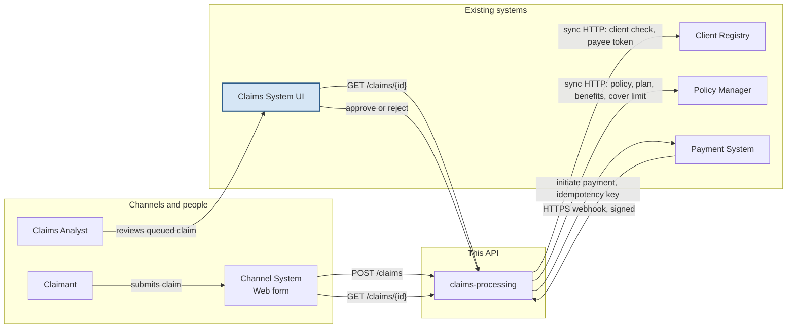

`claims-processing` is the link between the web form, the Claims System UI, the Client Registry, the Policy Manager, and the Payment System. The arrows are the ideal contract. The legend says what this sample calls.

## Legend

- Blue box: the Claims System UI already exists and is out of scope. This repo builds `claims-processing`, and that service is the claims system of record. These endpoints replace the existing Claims API. There is no second claims store.
- A queued claim is approved or rejected in that UI. On approval, `claims-processing` initiates payment. The decision endpoint is `POST /claims/{id}/decision`.
- Client Registry and Policy Manager are synchronous HTTP calls from a queue worker.
- Payment is assumed external (Third Party on the case-study diagram); the brief does not confirm this. Status arrives by a signed HTTPS webhook through API Gateway in the AWS mapping. The ideal queues that callback for a worker ([ADR-0002](../adr/0002-async-https-payment-webhook.md)). The sample applies it in the request. EventBridge and SNS are not used.

### Sample calls

- Client Registry: `GET /clients/{id}`. HTTP 200 with status `ACTIVE` is a known client. HTTP 200 with status `DECEASED` is a known client only when the claim is a death claim. HTTP 404 is an unknown client and a business rejection. Any other HTTP 200 is treated as unavailable.
- Policy Manager: `GET /policies/{policyNumber}/cover?claimType=`. The body is `policyNumber`, `status`, and `covered`. `ACTIVE` and covered is covered. `LAPSED` is lapsed. HTTP 404, or `ACTIVE` with covered false, is no cover.
- Payment: `POST /payments` with `claimId`, `clientId`, `policyNumber`, and `amount`, and the header `Idempotency-Key` set to the claim id. The sample does not send a payee.

### Ideal contract

- Client Registry returns the payee as well as the client check. On a death claim the life assured and the beneficiary can be different people, and the account token is the beneficiary's. A client who is not `ACTIVE`, and not `DECEASED` on a death claim, is a business result, and a timeout is unavailable. The registry returns an account token. This service does not store the account number.
- Policy Manager returns the plan, the benefit, a cover limit, a waiting period, and whether `incidentDate` falls inside the term. An amount above the cover limit goes to an analyst even when it is under the straight-through ceiling. The straight-through ceiling stays this service's rule for paying without an analyst.
- The channel sends an idempotency key on `POST /claims`. A repeat returns the same claim id, so a double submit cannot start two payments.
