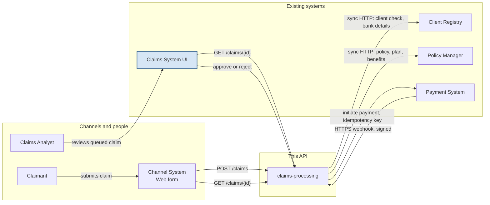

These systems are not connected today. This diagram shows the links the solution proposes.

## Legend

- Blue box: the Claims System UI already exists and is out of scope. This repo builds `claims-processing`.
- A queued claim is approved or rejected in that UI. On approval, `claims-processing` initiates payment. The decision endpoint is `POST /claims/{id}/decision`.
- Client Registry and Policy Manager are synchronous HTTP calls from a queue worker.
- Payment is assumed external (Third Party on the case-study diagram); the brief does not confirm this. Status arrives by a signed HTTPS webhook through API Gateway in the AWS mapping. ADR-0002's target queues the callback for a worker; the sample applies it in the request (see the ADR-0002 implementation note). EventBridge and SNS are not used.
