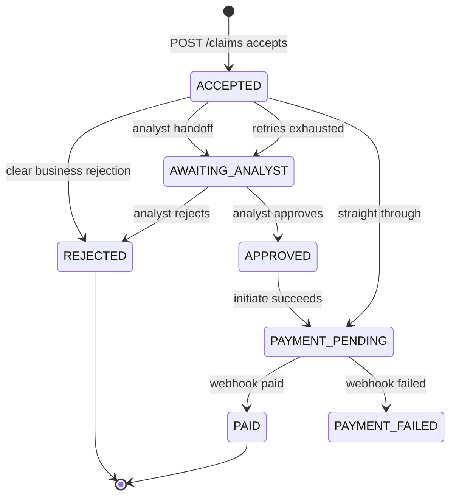

Statuses a stored claim can sit in, and the transitions between them.

## Legend

- Straight through means the claim is not a death claim, the client and policy checks pass, the amount is under the set limit, there is no flag, and payment initiate has succeeded. The limit and the meaning of a flag stay on the Open table.
- Analyst handoff means a death claim that is not a clear business rejection, a high amount, a flag, or a borderline case. The meanings of flag and borderline stay on the Open table.
- Clear business rejection means unknown client, lapsed policy, or no cover. It is not retried.
- Retries exhausted change the status only from `ACCEPTED`, to `AWAITING_ANALYST`. Analyst rejection ends at `REJECTED`. The UI makes that decision. The endpoint path stays on the Open table.
- Analyst approves moves the claim from `AWAITING_ANALYST` to `APPROVED`. `APPROVED` moves to `PAYMENT_PENDING` when payment initiate succeeds. Until then the claim stays `APPROVED`.
- Retries exhausted in `APPROVED` leave the claim `APPROVED` and flag it for an analyst. The SLA clock has already stopped.
- A payment-status message that exhausts its retries leaves the claim `PAYMENT_PENDING` and flags it for an analyst. On a death claim the SLA clock keeps running.
- The webhook worker sets `PAID` or `PAYMENT_FAILED`. Queuing the webhook, a bad signature, and a repeat of the same idempotency key leave the status unchanged.
- `REJECTED` and `PAID` end. `PAYMENT_FAILED` has no outgoing arrow. What happens next is the new Open row: retry payment, analyst review, or terminal.
- For a death claim the SLA clock starts at `ACCEPTED` and stops at the analyst decision, or at `REJECTED` when no analyst decided. Approval is the move into `APPROVED`.
- A payload that fails input validation is HTTP 400 and never becomes a claim. The normal queue and the death-claim priority queue are not statuses.
