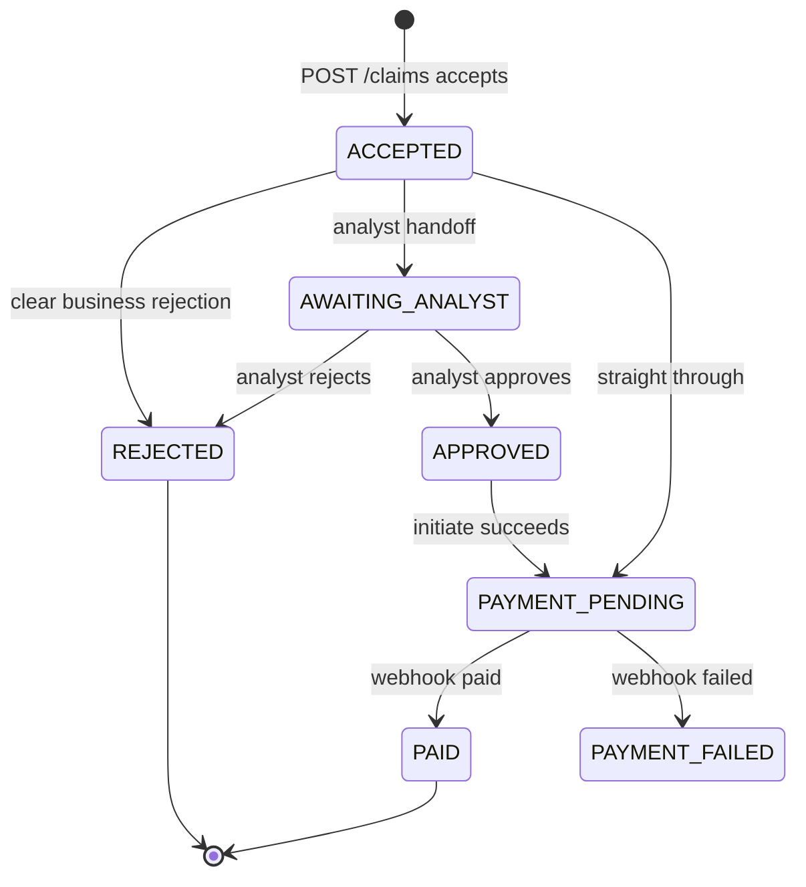
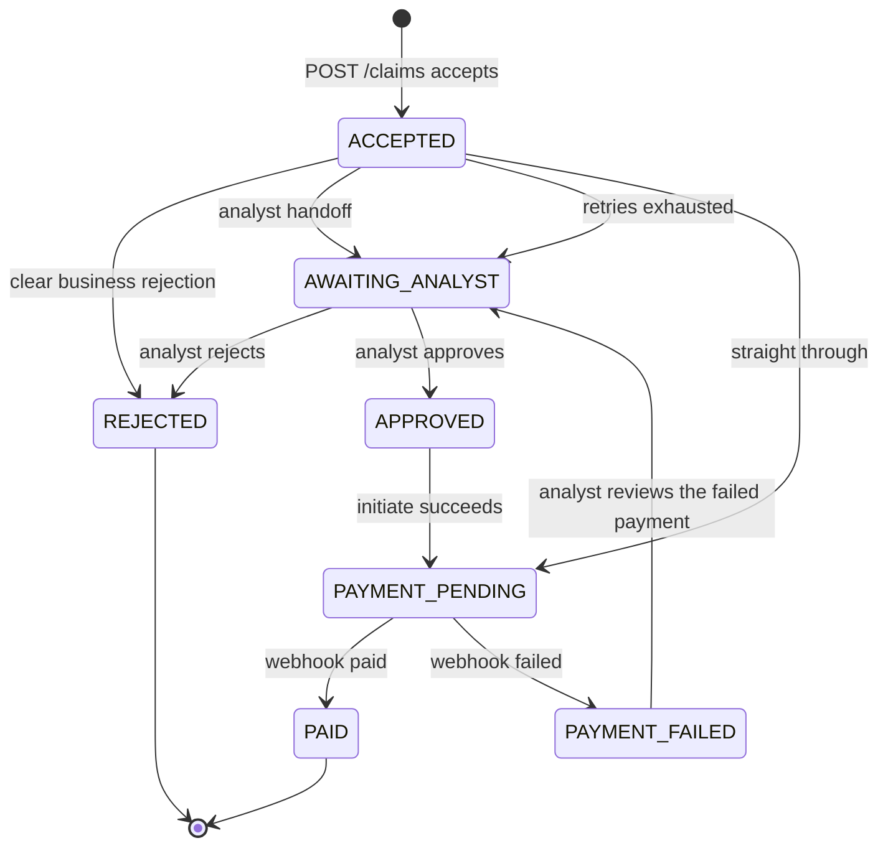

Statuses a stored claim can sit in. The first diagram is the sample this repo runs. The second is the ideal lifecycle. The ideal arrows are not in `ClaimStatus` yet.

## Sample

### Sample legend

- Straight through means the claim is not a death claim, the client and policy checks pass, the amount is strictly under `claims.straight-through.limit` (default `10000.00`), and the worker passed `flagged` as false. Payment initiate has then succeeded. Who sets a real flag, and what counts as borderline, stay on the Open table.
- Analyst handoff in the sample is a death claim, an amount at or above the limit, or `flagged` true. The worker always passes false, so only death and the limit send a claim to an analyst today.
- Clear business rejection means unknown client, lapsed policy, or no cover. The sample does not retry it.
- The Claims System UI approves or rejects with `POST /claims/{id}/decision`. Approve saves `APPROVED`, then initiates payment. Reject stores `ANALYST_REJECTED`.
- `APPROVED` moves to `PAYMENT_PENDING` only when initiate succeeds. A failed initiate leaves `APPROVED`. The sample has no retry.
- The callback is applied in the request. It sets `PAID` or `PAYMENT_FAILED`. A bad signature and a repeat of the same idempotency key leave the status unchanged.
- `REJECTED`, `PAID`, and `PAYMENT_FAILED` end. `PAYMENT_FAILED` has no outgoing arrow in the sample.
- For a death claim the SLA clock starts at `ACCEPTED` and runs while the claim is `ACCEPTED` or `AWAITING_ANALYST`. It stops at `APPROVED` or `REJECTED`.
- A payload that fails input validation is HTTP 400 and never becomes a claim. The normal queue and the death-claim queue are not statuses.
- The sample acknowledges the queue message after the claim has moved: a rejection, an analyst handoff, or a payment initiate. A downstream timeout leaves the message, and the next poll receives it again. A claim that is no longer `ACCEPTED`, and a missing claim, are acknowledged so they are not retried. The retries-exhausted arrow and the analyst flag are ideal-only.

## Ideal

### Ideal legend

- The same straight-through rule applies, with two additions. The Policy Manager cover limit is a separate check: an amount above that limit goes to an analyst even when it is under `10000.00`. A straight-through payment is recorded as a system approval, then uses the same initiate path as an analyst approval, so a paid claim always has an authoriser.
- Analyst handoff is a death claim that is not a clear business rejection, a high amount, a cover limit breach, a flag, or a borderline case. Who sets the flag, and what counts as borderline, stay open.
- Clear business rejection is still unknown client, lapsed policy, or no cover, and it is still not retried.
- Retries exhausted move the claim from `ACCEPTED` to `AWAITING_ANALYST` and flag it. The sample already acknowledges the message only after the claim has moved. The ideal adds four receives, backoff 1s then 2s then 4s, then the dead-letter queue, then the flag. See [ADR-0002](../adr/0002-async-https-payment-webhook.md).
- Initiate is retried while the claim stays `APPROVED`, with the same idempotency key. Exhausted initiate retries leave `APPROVED` and flag it. The processing clock stays stopped, because an analyst has already decided.
- The callback is queued, and HTTP 200 means the message is on the queue. A worker applies `PAID` or `PAYMENT_FAILED`. A death-claim payment update uses the death queue. See [ADR-0003](../adr/0003-prioritise-death-claims-separate-queue.md).
- `PAYMENT_FAILED` returns to `AWAITING_ANALYST`. On a death claim the SLA clock runs again, still measured from the original accept time, so the failed payment counts toward the four hours.
- A callback that itself exhausts its retries leaves the claim `PAYMENT_PENDING` and flags it. That wait belongs to the Payment System. This processing clock stays stopped while the status is `PAYMENT_PENDING`.
- The death-claim clock runs only in `ACCEPTED` and `AWAITING_ANALYST`. It stops at `APPROVED` or at `REJECTED` when no analyst decided. Returning from `PAYMENT_FAILED` is what makes the clock run again.
