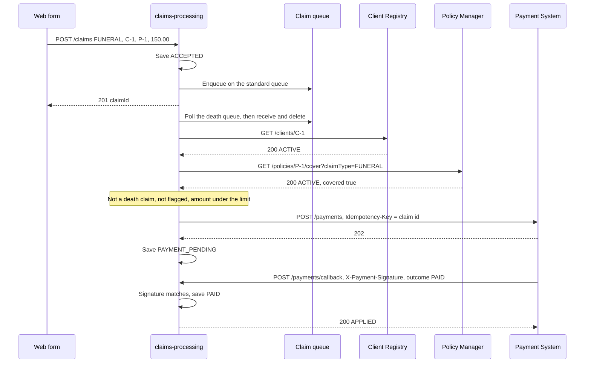
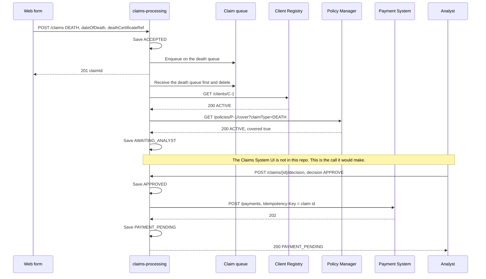
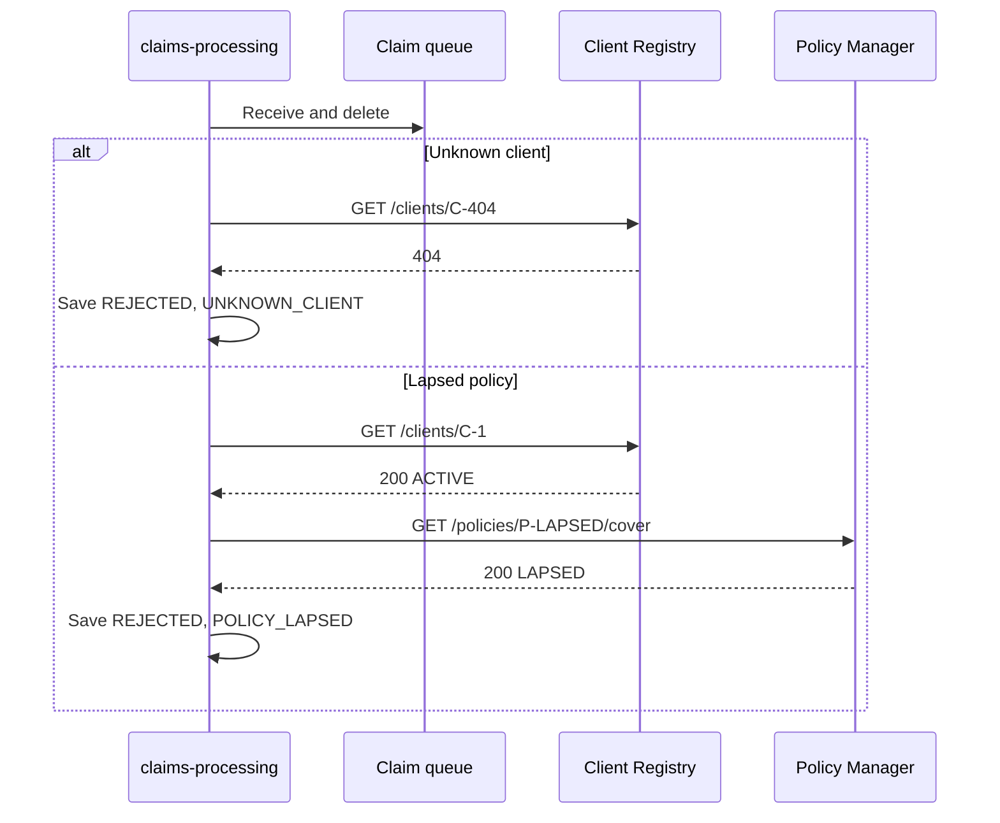
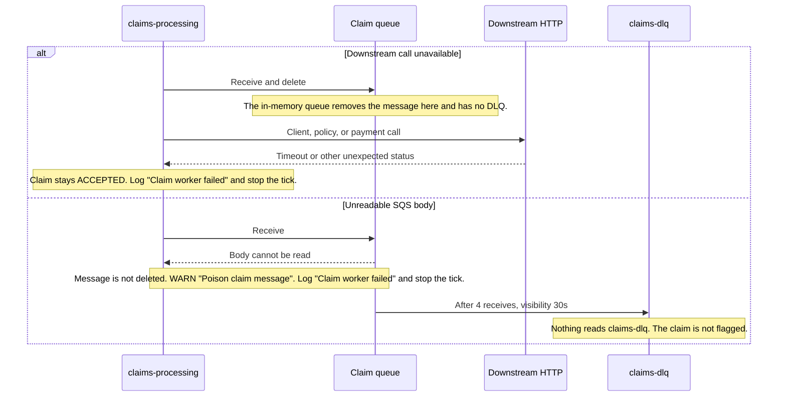
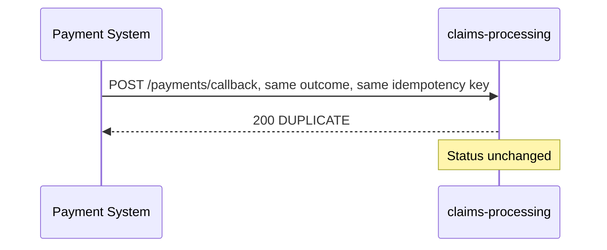
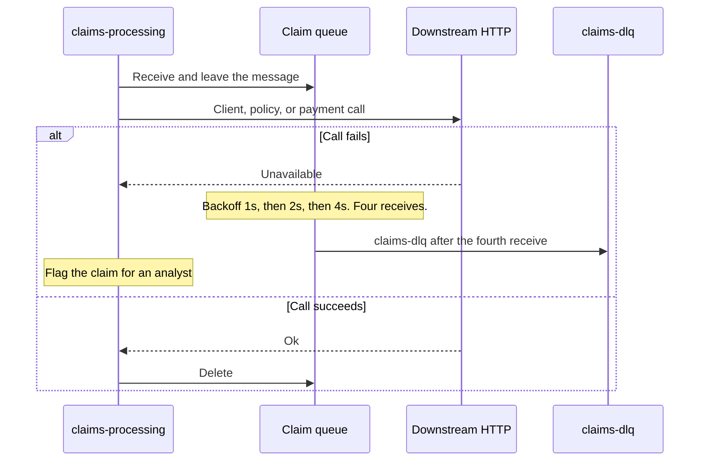
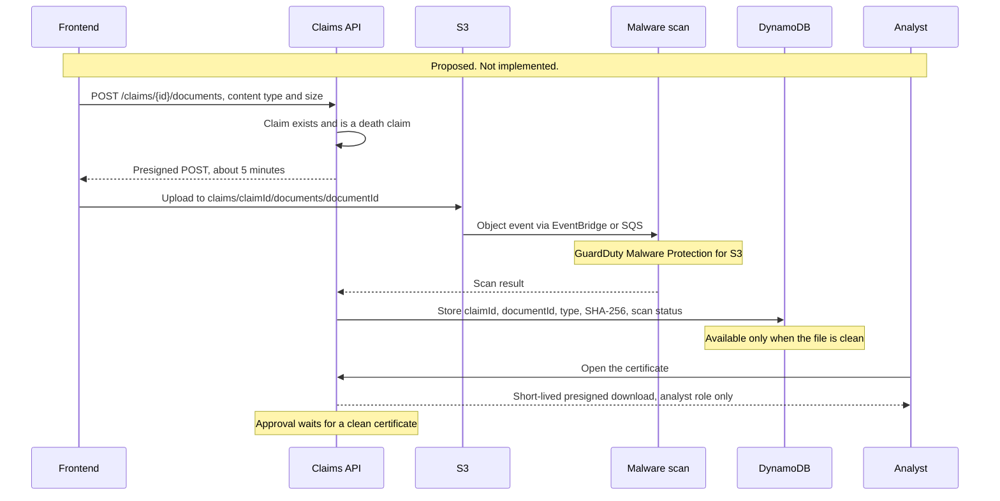

# Solution

## Description

`claims-processing` is the Claims System API, and it is the link to the Client Registry, the Policy Manager, and the Payment System. A web form submits a claim as JSON. This repo has no Claims System UI. The service owns input checks, the claim lifecycle, the order of the steps, failure handling, and death-claim priority. Client rules stay in the Client Registry. Policy rules stay in the Policy Manager.

`POST /claims` validates the body, stores the claim as `ACCEPTED`, and enqueues it. A death claim goes on the death queue. Every other claim goes on the standard queue. A scheduled worker polls the death queue first. It checks the client, then the policy. When both checks pass, a claim that is not a death claim, is not flagged, and whose amount is strictly under `claims.straight-through.limit` (default `10000.00`) starts payment. The worker passes `flagged` as false. Any other claim that passed both checks becomes `AWAITING_ANALYST`. An analyst approves or rejects it with `POST /claims/{id}/decision`. Approve moves the claim to `APPROVED` and initiates payment. Payment is `POST /payments` with the header `Idempotency-Key` set to the claim id. The Payment System later calls `POST /payments/callback` with an HMAC-SHA256 signature. The endpoint checks the signature and applies the outcome in that request: `PAID` sets the claim to `PAID`, and `FAILED` sets it to `PAYMENT_FAILED`. A scheduled check can raise a death-claim SLA warning or breach. The clock runs from accept while the claim is `ACCEPTED` or `AWAITING_ANALYST`.

The fields are `clientId`, `policyNumber`, `claimType` (`DEATH`, `DISABILITY`, or `FUNERAL`), `amount`, and `incidentDate`. A death claim also includes `dateOfDeath` and `deathCertificateRef`. A body that fails validation is HTTP 400 and is never queued. `GET /claims/{id}` returns the stored claim.

See the [context diagram](diagrams/context.md), the [claim states](diagrams/state-claim.md), [ADR-0001](adr/0001-single-service-outbound-ports.md), [ADR-0002](adr/0002-async-https-payment-webhook.md), [ADR-0003](adr/0003-prioritise-death-claims-separate-queue.md), and [ADR-0004](adr/0004-death-claim-sla-alarms-through-an-outbound-port.md).

On AWS this maps to one service on ECS Fargate behind API Gateway, SQS (`claims-death`, `claims-standard`, and `claims-dlq`), DynamoDB table `claims`, CloudWatch alarms, and Secrets Manager. This sample reads the callback secret from `PAYMENT_CALLBACK_SECRET` and logs the SLA alarm. Profile `localstack` uses LocalStack for SQS and DynamoDB. The default profile keeps the queue and the claim repository in memory.

## Architecture

The service is one deployable with four layers. `domain` holds the claim, its statuses, and the transition rules, and it is plain Java. `application` holds the use cases and the ports, and it depends only on `domain`. `adapter` implements the ports: HTTP in, the worker and SLA schedulers, and the clients for the Client Registry, Policy Manager, Payment, the queue, claim storage, and the SLA alarm. `config` constructs the beans. Dependencies point inward. [ADR-0001](adr/0001-single-service-outbound-ports.md) records this shape. `ArchitectureTest` fails the build if a layer depends outward, if `domain` or `application` uses Spring, if one adapter depends on another, or if a field is injected with `@Autowired`.

## How the systems interact

These sequences are what the code does. With profile `localstack`, the death queue is SQS `claims-death`, the standard queue is SQS `claims-standard`, and claims are stored in DynamoDB table `claims`. The default profile uses an in-memory queue and an in-memory repository. The steps are the same.

### Straight-through claim to PAID

The payment body is `claimId`, `clientId`, `policyNumber`, and `amount`. The client also treats HTTP 409 from `POST /payments` as accepted. The callback key is the claim id.

### Death claim to PAYMENT_PENDING

`PAID` follows the same callback as the straight-through claim.

### Rejection

Policy Manager HTTP 404, or HTTP 200 with status `ACTIVE` and `covered` false, is `NO_COVER`. These rejections are not retried. An unknown client does not call the Policy Manager.

### Failure, redrive, and a duplicate callback

If payment initiate fails after `APPROVE`, the claim stays `APPROVED`.

#### Target, not implemented (ADR-0002)

### Death-certificate upload (proposed, not implemented)

The presigned POST is locked to `claims/{claimId}/documents/{documentId}`, allows PDF, JPEG, or PNG, and limits the object to about 10 MB. The browser uploads to S3, so the service never handles the file. The bucket is private, with Block Public Access, SSE-KMS, versioning, Object Lock for the retention period, a lifecycle rule to Glacier, and CloudTrail data events. The object is sensitive personal data (POPIA). In this design the S3 adapter would implement a new outbound port, `DocumentStore`. LocalStack Community can serve S3 and presigned URLs, so this could be tested locally by adding `s3` to `SERVICES`; the current Compose file only enables `sqs` and `dynamodb`.

### Reliability

- The idempotency key is the claim id. Initiate sends it as `Idempotency-Key`, and the callback must echo it. The same outcome again is `DUPLICATE` and does not write the claim. A key that is not the claim id is HTTP 400. A callback for a claim that is not `PAYMENT_PENDING`, and is not already in that outcome's status, is HTTP 409.
- The callback signature is HMAC-SHA256 of the raw body, in the header `X-Payment-Signature`. The sample reads the key from `PAYMENT_CALLBACK_SECRET`. A bad signature is HTTP 401 and is not applied. Secrets Manager is the AWS mapping for that secret.
- The Client Registry, Policy Manager, and Payment clients use a connect timeout of 2s and a read timeout of 5s.
- `init-aws.sh` creates `claims-dlq` and sets `maxReceiveCount` to 4 and visibility to 30 seconds on `claims-death` and `claims-standard`. A body that can be read is deleted before the outbound call, so a downstream failure does not use that redrive.
- The death-claim SLA is `claims.death-sla.duration` (`PT4H`) from accept, with a warning at `warning-fraction` `0.75`, checked every `check-interval` (`PT1M`). The clock runs only while the claim is `ACCEPTED` or `AWAITING_ANALYST`. The sample logs a warning at WARN and a breach at ERROR, with the claim id and the elapsed time. CloudWatch is the AWS mapping. The set of alarms already raised is in memory, so a restart can raise the same alarm again.
- Backoff timing, analyst flagging after the DLQ, a claim left `APPROVED`, and what happens after `PAYMENT_FAILED` are still open. The table below is the full list.

## Assumptions

- Queues and claim storage sit behind ports. The default profile is in memory. Profile `localstack` uses SQS and DynamoDB.
- The ideal design is event sourcing: rebuild the claim from its events and publish those events. This sample stores a short event list on the claim, including on the DynamoDB item. Payment status stays the webhook from ADR-0002.
- The running system maps to API Gateway, ECS Fargate, SQS (`claims-death`, `claims-standard`, `claims-dlq`), DynamoDB, CloudWatch alarms, and Secrets Manager. Payment status uses neither EventBridge nor SNS.
- The Payment System is assumed external because of its Third Party label on the case-study diagram. The brief does not confirm that, so status arrives by a signed HTTPS webhook.
- The 4-hour death-claim SLA is the configured default and is still pending business confirmation.
- Authentication of claimants, analysts, and the channel is out of scope. The webhook signature is in scope.
- Partial payments are out of scope.
- The Client Registry, Policy Manager, and Payment are reached only through outbound ports. Tests and Compose mock them with WireMock.

## Recommended changes

1. **The Payment System publishes payment events, or retries the webhook with backoff.** ADR-0002 leaves EventBridge as the upgrade if Payment is internal, and it expects an external Payment System to call the webhook again when this service is down. The sample applies the callback in the request. The Compose payment stub returns 202 and does not call back. `scripts/demo.ps1` sends the callback itself.
2. **The Claims System UI calls `POST /claims/{id}/decision` and reads `GET /claims/{id}`.** The UI already exists and is outside this repo. Approve is the path that starts payment. The sample does not authenticate that call.
3. **The Client Registry and the Policy Manager publish versioned OpenAPI, and they distinguish not found from unavailable.** The adapters already map HTTP 404 to a business result and map timeouts and other statuses to an unavailable error. Policy Manager 404 becomes `NO_COVER`, so a missing policy and a policy with no cover are one result. A client response of HTTP 200 whose status is not `ACTIVE` is unavailable, not an unknown client. A contract would make those splits explicit.
4. **The Policy Manager returns a cover limit.** Straight-through uses `claims.straight-through.limit`. The policy payload today is `policyNumber`, `status`, and `covered`.
5. **Every system carries this claim id, and a correlation id.** The claim id is already the idempotency key and the callback's `claimId`. None of the outbound calls send a correlation id.
6. **Claim history is event sourced.** The event list stored on the claim is a step toward rebuilding state from events and publishing them. The payment webhook stays as ADR-0002 decided.
7. **Delete the SQS message only after processing succeeds.** `SqsClaimQueue.receive` deletes the message before the client, policy, and payment calls. `maxReceiveCount` 4 therefore never sees those failures, and `claims-dlq` does not mean the downstream call failed. `InMemoryPriorityClaimQueue.receive` drops the message at the same point.
8. **Death-certificate upload, proposed and not implemented.** Diagram (e) is the flow. The frontend would call `POST /claims/{id}/documents` with the content type and size. The service would check that the claim exists and is a death claim, then return a presigned POST of about 5 minutes, locked to `claims/{claimId}/documents/{documentId}`, for PDF, JPEG, or PNG, up to about 10 MB. The browser would upload to S3. An S3 event would reach GuardDuty Malware Protection for S3 through EventBridge or SQS, and only a clean file would be marked available. The claim's DynamoDB item would store `claimId`, `documentId`, type, SHA-256, and scan status. Analysts would receive a short-lived presigned download, and only an analyst role would receive one. An analyst could not approve a death claim until it had a clean certificate. The bucket would be private, with Block Public Access, SSE-KMS, versioning, Object Lock for the retention period, a lifecycle rule to Glacier, and CloudTrail data events, because the object is sensitive personal data (POPIA). The hexagonal shape would add an outbound port, `DocumentStore`, with an S3 adapter. LocalStack Community can serve S3 and presigned URLs, so this could be tested locally by adding `s3` to `SERVICES`; the current Compose file only enables `sqs` and `dynamodb`.

## Open

A row without a decided value is still open. Do not invent values for these.

| Item | Where it is set |
|---|---|
| Backoff timing | `init-aws.sh` sets visibility to 30 seconds and `maxReceiveCount` to 4. The ADR-0002 delays of 1s, 2s, and 4s are not implemented. |
| In-memory queue drops a message on receive | `InMemoryPriorityClaimQueue.receive` removes the message before processing. A later failure loses it. There is no in-memory DLQ. |
| Analyst flagging after the DLQ | Not implemented. |
| Retry payment for a claim left `APPROVED` | Approve is saved before initiate. A failed initiate leaves `APPROVED`. There is no retry. |
| Who sets the flag | `ClaimWorkerService` passes `false`. Who sets the flag is open. |
| Payee bank details | Not on the client response or the payment request. |
| What happens after `PAYMENT_FAILED` | `PAYMENT_FAILED` has no onward transition. |
| Authentication of claimants, analysts, and the channel | Out of scope. The webhook signature is implemented. |
| What counts as borderline | No rule in the code. |
| Whether the analyst queue is a separate port | `AWAITING_ANALYST` is a status. ADR-0001 left a separate port open. |
| Currency and scale of `amount` | `amount` is a `BigDecimal`. There is no currency field. |
| Save-then-enqueue gap | `SubmitClaimService` saves, then enqueues. There is no outbox. |
| Queue the payment callback before applying it | `POST /payments/callback` applies the status in the request. ADR-0002's queue-then-worker is not implemented. |
| `state-claim.md` says the death-claim clock keeps running in `PAYMENT_PENDING`. ADR-0004 and the code stop it at `APPROVED` or `REJECTED`. This file follows ADR-0004. | The diagram file is unchanged. |
